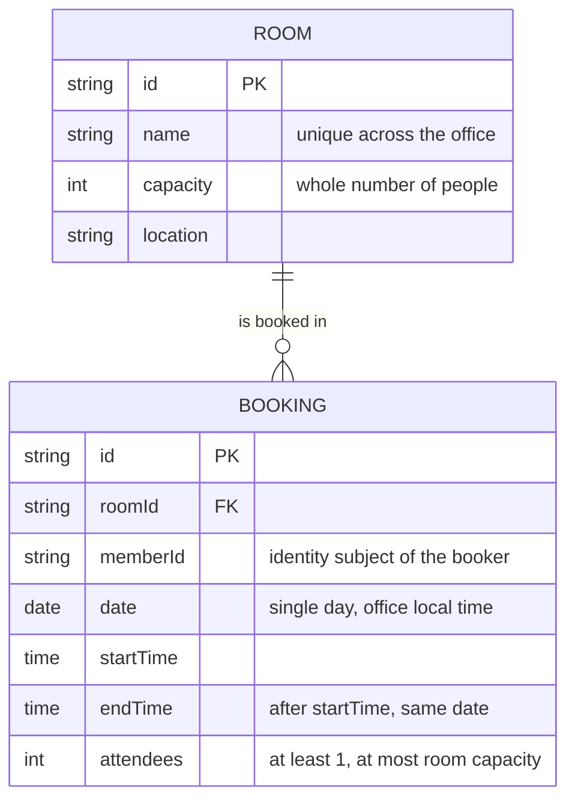

# Domain model

The office's rooms are a fixed, seeded set; Members book them for a single day. A Member is the signed-in person, known to the app only by their identity subject.

- A booking belongs to the Member who made it (`memberId`); only that Member may cancel it. Cancelling deletes the row.
- Two bookings of one room clash when their time ranges overlap; touching ranges do not.